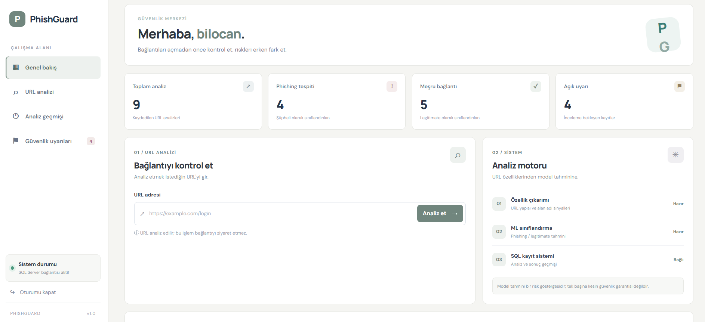
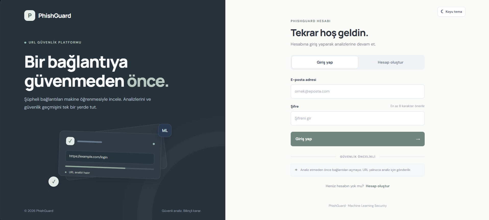
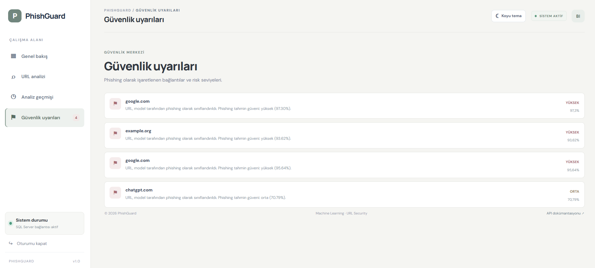
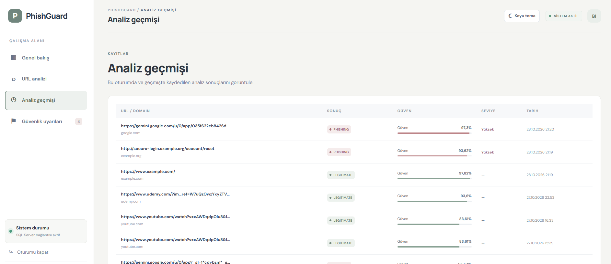
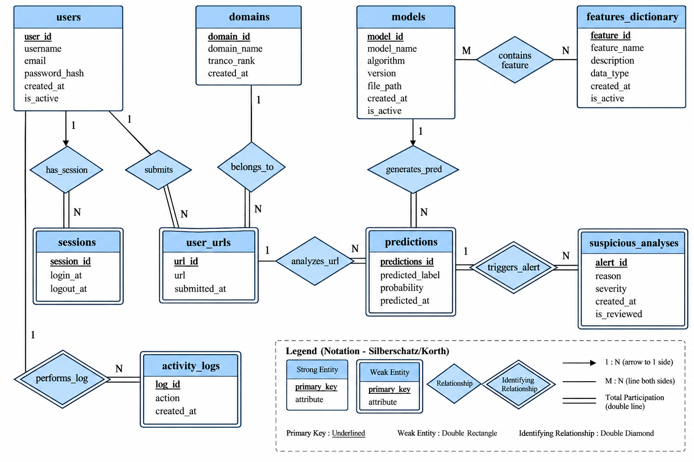

# PhishGuard

**Machine Learning–Based Phishing URL Detection with a Relational Database Backend**

PhishGuard is an end-to-end cybersecurity application that analyzes URLs to identify potential phishing threats using machine learning. It combines URL feature extraction, model inference, a web interface, and a Microsoft SQL Server database to analyze URLs and maintain prediction history.

Beyond URL classification, the project explores the integration of machine learning workflows with a relational database, including data integrity, stored procedures, triggers, views, and activity logging. It also includes model training workflows, automated tests, and deployment configuration.

**Repository:** [Bilal-gul/phishguard-database](https://github.com/Bilal-gul/phishguard-database)

**Latest optimized model:** [PhishGuard Optimized Model v1.0.0](https://github.com/Bilal-gul/phishguard-database/releases/tag/v1.0.0)

---

## Application Preview

### Home Page

The main application interface for accessing PhishGuard's URL analysis functionality.

<p align="center">
  
</p>

### User Registration

The registration interface for creating a user account.

<p align="center">
  
</p>

### Safety Warnings

Safety-related information presented to users while interacting with the application.

<p align="center">
  
</p>

### Analysis History

The analysis history interface for reviewing previously submitted URLs and their prediction results.

<p align="center">
  
</p>

---

## Key Features

- **Phishing URL Detection:** Classify submitted URLs using a trained machine learning model.
- **URL Feature Extraction:** Extract URL-based features required for model inference.
- **Web Interface:** Interact with the application through its frontend.
- **Analysis History:** Store submitted URLs and their prediction results in the database.
- **User Management:** Maintain user accounts, login sessions, and activity records.
- **Suspicious Activity Alerts:** Generate database alerts for configured suspicious prediction conditions.
- **Relational Database Design:** Use constraints, relationships, views, triggers, and stored procedures to support data consistency and analysis records.
- **Model Management:** Maintain model metadata and the features associated with each model.
- **Training Workflows:** Organize model training, preprocessing, benchmarking, and search-space comparison scripts.
- **Model Release Management:** Distribute the optimized model separately through a versioned GitHub Release.
- **Automated Testing:** Include tests for inference, feature extraction, training workflows, API behavior, and deployment configuration.
- **Containerization:** Provide Docker and Docker Compose configuration for application deployment.

## How It Works

```text
             URL Submission
                   |
                   v
          URL Feature Extraction
                   |
                   v
         Machine Learning Inference
                   |
                   v
             Prediction Result
                   |
                   v
          SQL Server Database
                   |
           +-------+--------+
           |       |        |
           v       v        v
        Analysis  Suspicious Activity
        History      Alerts
                   |
                   v
              Activity Logs
```

The application performs URL feature extraction and machine learning inference. SQL Server stores and manages the resulting records; the database does not execute the machine learning model itself.

## Machine Learning

PhishGuard includes model inference code as well as scripts for training and evaluating machine learning models.

The training workflow is organized into preprocessing, model pipeline, optimized training, benchmarking, and search-space comparison components.

### Training and Evaluation Workflows

The repository includes scripts for:

- Dataset preprocessing and feature preparation.
- Model training and pipeline execution.
- Optimized model training.
- Training benchmarks.
- Comparison of model search spaces.
- Automated tests for training and preprocessing components.

The main training entry points are:

| Script | Purpose |
|---|---|
| `train_optimized.py` | Launches the optimized model training workflow |
| `benchmark_training.py` | Runs the training benchmark workflow |
| `compare_search_spaces.py` | Compares model search-space configurations |

Training requires the appropriate datasets and dependencies. Review the training configuration and dataset paths before starting a new run.

### Optimized Model Release

The optimized model is distributed through the GitHub Releases page rather than being added as a large binary to the regular source-code history.

- **Release:** [PhishGuard Optimized Model v1.0.0](https://github.com/Bilal-gul/phishguard-database/releases/tag/v1.0.0)
- **Model format:** Joblib
- **Model type:** Random Forest
- **Feature count:** 122
- **Label `0`:** Phishing
- **Label `1`:** Legitimate URL

For download, checksum verification, and model installation instructions, see [`PhishGuard/MODEL_RELEASE.md`](PhishGuard/MODEL_RELEASE.md).

The application supports configuring the model path through `PHISHGUARD_MODEL_PATH`. Refer to the model release guide for the supported loading and installation workflow.

**Security note:** Model predictions are not guarantees. A URL classified as legitimate may still be malicious, and a phishing URL may not always be detected.

## Tech Stack

| Component | Technology |
|---|---|
| Backend | Python, FastAPI |
| Frontend | HTML, CSS, JavaScript |
| Database | Microsoft SQL Server |
| Database Management | SQL Server Management Studio (SSMS) |
| Machine Learning | Python, scikit-learn, Random Forest, URL feature extraction |
| Model Serialization | Joblib |
| Testing | pytest |
| Containerization | Docker, Docker Compose |
| Version Control and Model Distribution | Git, GitHub Releases |

## Database Design

The database manages user accounts, submitted URLs, domains, model predictions, suspicious-case alerts, and activity history through a relational schema.

### Entity-Relationship Diagram

<p align="center">
  
</p>

<p align="center">
  <em>PhishGuard relational database schema.</em>
</p>

### Database Tables

| Table | Purpose |
|---|---|
| `users` | Stores user accounts and account status |
| `sessions` | Stores login session records |
| `domains` | Stores domain information and Tranco rank |
| `user_urls` | Records URLs submitted for analysis |
| `models` | Maintains machine learning model metadata |
| `features_dictionary` | Defines the features used by ML models |
| `model_features` | Maps models to their features using a many-to-many relationship |
| `predictions` | Stores model prediction results |
| `suspicious_analyses` | Records alerts associated with suspicious predictions |
| `activity_logs` | Maintains user activity and audit history |

### Relationships and Constraints

The schema uses primary keys and foreign keys to maintain relationships between users, URLs, domains, models, predictions, and alerts.

Additional constraints include:

- Unique usernames and email addresses.
- Unique domain names and feature names.
- A composite primary key on `model_features` (`model_id`, `feature_id`).
- Prediction labels restricted to `0` or `1`.
- Prediction probabilities restricted to the range `[0, 1]`.
- Activity types restricted to supported actions such as `REGISTER`, `LOGIN`, `URL_ANALYSIS`, and `LOGOUT`.

**Prediction labels:** `0` represents phishing, while `1` represents a legitimate URL.

### Database Objects

**View — `analysis_history`**

Combines URL submissions, domain information, predictions, and model records into a convenient analysis-history view.

**Triggers**

- **URL analysis logging:** Automatically creates a `URL_ANALYSIS` activity entry when a URL submission is inserted.
- **Suspicious prediction detection:** Creates an alert when a prediction is labeled as phishing and the associated domain meets the configured Tranco rank condition (`rank <= 10,000`).

**Stored Procedure — `record_url_analysis`**

Coordinates the database-side steps of a URL analysis, including ensuring the domain record exists and creating the URL and prediction records.

Feature extraction and machine learning inference remain the responsibility of the application.

**Data Integrity and Transactions**

Primary keys, foreign keys, unique constraints, and check constraints help preserve data consistency. Transactional operations can prevent failed analyses from leaving incomplete database records.

## Getting Started

### Prerequisites

- Git
- Python and pip
- Docker and Docker Compose
- Microsoft SQL Server

### 1. Clone the Repository

```bash
git clone https://github.com/Bilal-gul/phishguard-database.git
cd phishguard-database
```

### 2. Configure Environment Variables

Navigate to the application directory:

```powershell
cd PhishGuard
```

Create your local `.env` file from the example:

```powershell
Copy-Item .env.example .env
```

Edit `.env` and configure the required database connection settings for your environment.

> **Security:** Never commit your `.env` file, database passwords, API keys, or other secrets to GitHub. Use `.env.example` to document the required configuration without exposing real credentials.

### 3. Start the Application

From the `PhishGuard` directory, build and start the Docker services:

```bash
docker compose up -d --build
```

Check the container status:

```bash
docker compose ps
```

View application logs if needed:

```bash
docker compose logs -f
```

Make sure SQL Server is running and that the connection settings in `.env` match your environment. The available services and their configuration are defined in `PhishGuard/docker-compose.yml`.

## Training, Testing, and Development

The repository includes a separate dependency file for model training and development workflows.

From the repository root, create and activate a Python virtual environment, then install the required dependencies:

```bash
python -m venv .venv
```

On Windows PowerShell:

```powershell
.\.venv\Scripts\Activate.ps1
```

Install the training and development requirements:

```bash
pip install -r requirements-training.txt
```

### Run the Training Workflows

After preparing the datasets and reviewing the configured paths, the training workflows can be launched from the repository root:

```bash
python train_optimized.py
```

For additional experiments:

```bash
python benchmark_training.py
python compare_search_spaces.py
```

These scripts may require substantial memory, processing time, and disk space depending on the dataset and configuration.

### Run the Tests

From the repository root:

```bash
pytest
```

The test suite covers components including feature extraction, inference, preprocessing, training workflows, API and database behavior, and deployment configuration.

## Repository Structure

```text
phishguard-database/
├── README.md
├── screenshots/
│   ├── home-page.png
│   ├── registration.png
│   ├── safety-warnings.png
│   ├── analysis-history.png
│   └── Phishguard_db_diagram.png
├── sql/
│   ├── Phishguard_create_database.sql
│   ├── Phishguard_create_table.sql
│   ├── Phishguard_procedure.sql
│   ├── Phishguard_triggers.sql
│   └── Phishguard_view.sql
├── PhishGuard/
│   ├── backend/
│   ├── frontend/
│   ├── data/
│   │   └── best_model.pkl
│   ├── main.py
│   ├── predict.py
│   ├── feature_extractor.py
│   ├── model_artifact.py
│   ├── requirements.txt
│   ├── MODEL_RELEASE.md
│   ├── Dockerfile
│   ├── docker-compose.yml
│   ├── .dockerignore
│   └── .env.example
├── training/
│   ├── benchmark_training.py
│   ├── compare_search_spaces.py
│   └── train_optimized.py
├── tests/
├── fit.py
├── model.py
├── model_pipeline.py
├── optimized_model_pipeline.py
├── preprocessing.py
├── train_optimized.py
├── benchmark_training.py
├── compare_search_spaces.py
├── requirements-training.txt
└── .gitignore
```

Large model artifacts and datasets are not all stored in the regular Git history. Consult the model release documentation for the optimized model distribution workflow.

## SQL Scripts

The `sql/` directory contains the scripts used to define and configure the database.

| Script | Purpose |
|---|---|
| `Phishguard_create_database.sql` | Creates the database |
| `Phishguard_create_table.sql` | Defines tables and relational constraints |
| `Phishguard_procedure.sql` | Defines stored procedures |
| `Phishguard_triggers.sql` | Defines database triggers |
| `Phishguard_view.sql` | Defines database views |

Execute the scripts against your SQL Server instance in the appropriate order, beginning with database creation and table definitions.

## Project Goals

PhishGuard brings together machine learning, cybersecurity, web application development, and relational database design in a practical end-to-end project.

The application focuses on phishing URL detection, while the training workflows support model development and evaluation. The database provides structured analysis history, model metadata, suspicious-case tracking, activity auditing, and data integrity.

The project is designed to demonstrate how an ML-powered cybersecurity application can be developed, tested, packaged, and documented as a complete software engineering project.

---

**Author:** [Bilal-gul](https://github.com/Bilal-gul)

**Repository:** [phishguard-database](https://github.com/Bilal-gul/phishguard-database)
